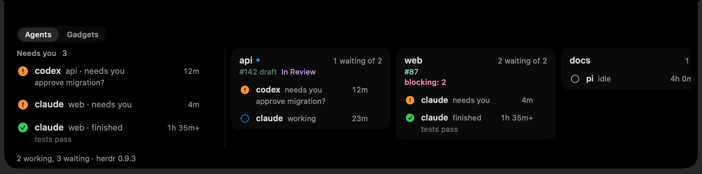

# 🐑 Shepherd

**Your coding agents, in the notch.** Shepherd is a small native macOS app that watches every
coding agent you run in a terminal (Claude Code, Codex, or your own) and tells you which ones need
you. Answer an approval, prompt an idle agent or start a new task from the notch or a palette,
without switching to the terminal.

<picture>
  <source media="(prefers-color-scheme: light)" srcset="Tests/ShepherdUITests/__Snapshots__/notch-bar.light.png">
  
</picture>

- **Glanceable.** A paw by the notch turns orange with a count when an agent is blocked or
  finished. Hover it for the whole herd: who needs you first, then every project.
- **Act where you are.** Approval prompts become buttons. Reply, prompt or jump to the agent's
  terminal from any app.
- **Calm and light.** Nothing leaves your Mac, no telemetry, no CPU when idle (0.00% CPU and
  14 MB measured idle against a fake herdr). See [Privacy](#privacy).

> Status: early, and built from source for now. See the
> [issues](https://github.com/Flexipie/shepherd/issues) and [docs/ROADMAP.md](docs/ROADMAP.md).

## Where agents come from

Shepherd does not run agents. It finds the ones you already run, from any of these sources,
together or alone:

| Source | What you need | What you get |
| --- | --- | --- |
| **tmux** | Your agents running in tmux panes | Every Claude Code or Codex pane, found by its process. Its state is read from the screen, and you can read its last lines, answer approvals, prompt it, jump to it and start new tasks. Teach it other agents in config. |
| **Agent reports** | `shepherd-report install claude`, or any agent that runs `shepherd-report report` | Exact state from the agent itself, through its hooks. On their own, status only: no reading, answering or jumping. |
| **herdr** | [herdr](https://herdr.dev) 0.9.3 or later, running | Everything herdr knows: workspaces, agents and their state, your herdr plugins' tokens (a PR, a ticket), plus reading, answering, jumping and new tasks, and Claude Code's context size and final message. |

**tmux is what the screen features need.** Without tmux (or herdr) Shepherd can only show what
agents report; it cannot read a screen, type into it or press an approval button. Run your agents
in tmux to get those.

Reports and the other sources work together. A Claude Code session with the hooks installed that
runs in a tmux pane or a herdr pane is one row: the pane's, so you can still read, answer, prompt
and jump to it, with the exact state from its report instead of the screen's reading (under herdr,
herdr's own state stays, and the report adds its message).

With no config file, every source that is on your Mac runs. Until the first agent shows, the
panel says which sources it found and what to do next.

## Install

There is no signed download or Homebrew formula yet; build it from source. You need:

- macOS 26 or later
- the Swift 6.2 toolchain (Xcode 26 or its command line tools)
- tmux for the screen features (`brew install tmux`), herdr optionally

```bash
git clone https://github.com/Flexipie/shepherd.git
cd shepherd
make app                      # builds build/Shepherd.app (release, ad-hoc signed)
cp -R build/Shepherd.app /Applications/
open /Applications/Shepherd.app
```

To have Claude Code report its own exact state (in any terminal, tmux and herdr included), add
Shepherd's hooks to its settings. It shows the change as a diff, asks first and keeps a backup;
`uninstall claude` removes exactly what it added:

```bash
/Applications/Shepherd.app/Contents/MacOS/shepherd-report install claude
```

Claude Code runs the hooks as `shepherd-report`, so it must be on your PATH. If it is not,
`install claude` says so before asking and prints the `ln -s` that puts it there.

Any other agent can report too, from its own hooks or scripts:
`shepherd-report report --status working|blocked|done|idle|closed [--message <text>]`.

To try Shepherd without real agents, right-click the menu bar icon and choose Try Demo (the
first-run guide points there too), or run `make demo` (the app with `--demo`, beside any Shepherd
already running). You get a made-up herd from all three sources: three herdr projects, two Claude
Code reports and two tmux agents, under a "Demo herd" card that says they are made up. Demo mode
reads and writes nothing of yours (no herdr, tmux, config, history, plugins or notifications);
Leave Demo in the same menu goes back.

## What it does

- **The notch.** A paw to the left of the notch turns orange with a count when agents need you.
  Hover it and a bar grows along the top of the screen: the needs-you queue (blocked first, then
  finished, longest waiting first), then one column per project. Hovering does not take your
  typing; click inside for the arrow keys, Return and Escape. Macs without a notch get a small
  floating pill instead: a blocked agent stays until handled, a finished one shows for a few
  seconds, and nothing shows for the pane you are already looking at.
- **Answer and prompt.** Click an agent in the bar to see its last lines. An approval prompt's
  choices are buttons (click one or press its digit); otherwise type a reply. An idle or finished
  agent gets a prompt field. ⌘-click, the row's arrow or ⌘Return jumps to its terminal instead.
- **Palette.** ⌥Space from any app opens a search box. Type part of an agent, a project, a state
  or any token (a PR number, a ticket) and press Return to jump. Tab (or →) on an agent turns the
  field into a prompt for it, with its last lines underneath; approval choices are ⌘1, ⌘2 and so
  on. Your current app stays frontmost.
- **"Next" hotkey.** ⌃⌥⌘N jumps to the next agent that needs you; press again to walk the queue.
- **New task.** The "+" after the project columns, or "New task…" in the palette: pick a project,
  an agent and a prompt (a branch name is optional). Shepherd makes a git worktree from that
  project's repo, starts the agent in it with the prompt, and shows you the new agent. In tmux the
  worktree goes next to the repo's folder (`app-fix-login` beside `app`) and the agent opens in a
  new background window of the same session.
- **Panel.** Click the paw icon in the menu bar for the same queue and projects as a list. Up and
  down move, Return jumps, Escape closes. Right-click the icon for the connection state, Try Demo and Quit.
- **Projects and worktrees.** tmux agents are grouped by git checkout and herdr's by workspace,
  and the worktrees of one repo share a card: the repo's name on top, then each checkout with its own agents. Type the repo's
  name in the palette to find them all.
- **Agents | Gadgets.** Two tabs (⌘1, ⌘2) in the panel and the bar. Gadgets holds **Usage** (your
  Claude Code, Codex and other plan limits with when each resets, read from
  [OpenUsage](https://github.com/robinebers/openusage) if it is running) and **This Mac** (CPU and
  memory). A gadget reads only while its tab shows. With every gadget turned off there are no
  tabs.
- **Context size and final message** (Claude Code under herdr, or reporting through its hooks
  outside tmux). A row shows how full the agent's context is ("184k"), and once it stops, its
  last message on one line; the stage and the palette show the whole message.
- **Notifications** (off by default; the notch is the alert). When on, an agent you are not
  looking at that blocks posts a macOS notification (with Jump, and Reply where its source allows it).
  Screen readings never notify; reports and herdr do.
- **Your herdr colours.** With herdr, token colours and rules come from herdr's own `[ui.sidebar]`
  config, so `$pr` and `$ticket_state` look as they do in its sidebar.
- **Honest state.** A state read from a screen is a best guess, so it never sends a
  notification or a plugin event. If a source's connection
  breaks, Shepherd says so, shows the last known state dimmed and recovers on its own. Times are
  "4m" when Shepherd saw the change and "4m+" when it only knows an upper bound.

A tip for MacBooks with a full menu bar: items can hide behind the notch. The notch and the
hotkeys work either way; to see the menu bar icon too, ⌘-drag it somewhere visible.

## Privacy

Shepherd runs on your Mac and talks to nothing outside it. No telemetry, no analytics, no update
check, no account.

- **Network:** none, except the Usage gadget, which asks OpenUsage on `127.0.0.1:6736` (loopback
  only) while the Gadgets tab shows. Shepherd holds no credentials and never calls a vendor API.
- **What it reads:** herdr's local socket and its `config.toml`; tmux's socket folder, to find
  its servers, and its pane list, the last lines
  of agent panes and the process table (`ps`), to tell which panes run an agent (a control client,
  `tmux -C`, is attached to each server to learn when a pane prints; it keeps only which pane did); the `.git` entries
  above an agent's folder; agent reports in its spool folder; for Claude Code under herdr, the
  tail of that session's file in `~/.claude/projects`; Claude Code's `settings.json`, to say on
  first run whether the hooks are installed; its own config and plugins folder.
- **What it writes:** a history of state changes in
  `~/Library/Application Support/Shepherd/transitions.jsonl` (the newest 5,000). Agent reports
  are files in `~/Library/Application Support/Shepherd/reports`: `shepherd-report` writes them and
  removes one when its agent closes, and Shepherd removes one a day after it blocked or finished.
  Demo mode uses only its own socket and report folder under `/tmp` (`shepherd-demo`). Only when
  you ask: keys and text typed into an agent, a git worktree and branch for a new
  task, and Claude Code's `settings.json` through `shepherd-report install`, after showing the
  diff, with a backup.
- **Plugins** are your own code and run with your permissions: when the palette opens (to list
  their actions), when you pick an action, and on the events they ask for. Only add ones you have
  read.

## Plugins

Add your own actions with a script in any language. A plugin is a folder in
`~/.config/shepherd/plugins/` with a `shepherd-plugin.json`:

```json
{
  "id": "open-pr",
  "actions": [{ "id": "open", "title": "Open the PR", "context": "project", "command": ["sh", "open.sh"] }]
}
```

Global actions show up in the palette; ⌘K on an agent or a project lists its own. The script
gets the target as environment variables (`SHEPHERD_CWD`, `SHEPHERD_PROJECT_PATH`,
`SHEPHERD_AGENT_ID`, `SHEPHERD_TOKENS` and more) and can print text, which the palette shows, or
JSON such as `{"tokens": {"pr": "#12"}}`, which sets tokens on that row for any agent. A plugin
can also run on agent events (`agent.blocked`, `agent.finished` and others), for states that herdr
or a report gives; a screen reading never fires one. See
`examples/plugins/` (every herdr plugin action in the palette, and a diff stat) and "Plugins" in
`docs/PRD.md`.

## Config

Optional. `~/.config/shepherd/config.json` (or `SHEPHERD_CONFIG_PATH`) is read on save; every key
can be left out:

```json
{
  "modules": ["status", "notch", "demo", "sources", "queue", "usage", "system", "projects",
              "notifications", "context", "plugins"],
  "tokens": {
    "projects": [[{ "token": "pr", "fg": "#94e2d5", "rules": [{ "contains": "draft", "dim": true }] }, "ticket_state"]],
    "agents": [["summary"]]
  },
  "hotkeys": { "next": "ctrl+option+cmd+n", "palette": "option+space" },
  "agents": { "claude": { "args": [] } },
  "notifications": "off",
  "plugins": { "disabled": [] },
  "sources": ["herdr", "report", "tmux"],
  "layout": { "agents": ["sources", "queue", "projects"], "gadgets": ["system", "usage"],
              "projects": ["api"] }
}
```

- `modules`: which modules run, in order. Panel sections follow this order (unless `layout`
  lists that tab); in the notch bar the queue stays on the left and the others follow as columns.
  `demo` shows something only in demo mode.
- `sources`: where agents come from, in the order listed: `herdr`, `report` (`shepherd-report`)
  and `tmux`. Left out, all three run, in that order. A change applies the next time Shepherd starts. tmux can be an
  object instead, to teach it an agent or change how it reads one:

  ```json
  { "source": "tmux", "agents": {
      "aider": { "process": "aider", "working": ["Thinking"], "idle": ["(?m)^>$"] } } }
  ```

  A pane is that agent when a process under its shell has the `process` name (by default the kind
  itself). `blocked`, `working` and `idle` are lists of regular expressions, matched against the
  last ten non-empty lines of the screen, each line trimmed; a state applies when every pattern in
  its list is found, checked in that order. A numbered prompt (`1. Yes`) is blocked for any agent.
  A kind replaces the built-in one of the same name or process (`claude`, `codex`); two of your
  kinds on one process are reported. Pattern changes apply on save.
- `layout`: choose and order what the panel and the bar show, without turning modules off.
  `agents` and `gadgets` list the sections of that tab in order (`sources` (the first-run guide),
  `queue` and `projects` on Agents; `usage` and `system` on Gadgets); one you leave out is
  hidden. `projects` names the project or repo columns to show first, in that order (a project
  or its repo's name); the rest follow.
- `tokens`: per section, lines of tokens in herdr's sidebar syntax (`fg`, `bold`, `dim`, and
  `rules` with `equals`, `contains`, `starts_with`, `gt`, `lt`, `ignore_case`, `hide`). A section
  you define replaces herdr's for that section; one you leave out uses herdr's
  (`ui.sidebar.spaces.rows` for projects, `ui.sidebar.agents.rows` for agents), and with neither,
  every token shows unstyled.
- `hotkeys.next` and `hotkeys.palette`: modifiers (`ctrl`, `option`, `cmd`, `shift`) and one key
  (a-z, 0-9, `space`, `return`, `tab`, `f1`-`f12`); `null` turns one off. macOS does not say when
  another app (Raycast and Alfred like ⌥Space too) already owns a combination, so if the palette
  does not open, pick another (`ctrl+option+space`, for example).
- `agents.<kind>.args`: extra arguments when a new task starts that agent, for example
  `"claude": { "args": ["--dangerously-skip-permissions"] }`. That flag lets Claude Code run every
  tool and command without asking you first, so nothing will block for approval; use it only
  where that is safe (a worktree you can throw away, a machine without secrets). Off unless you set
  it.
- `notifications`: `"off"` (the default), `"on"`, or `"auto"` (on unless herdr already posts
  system notifications itself, `ui.toast.delivery` "system" or "terminal"). macOS asks for
  permission the first time; if it is off in System Settings, the bar's footer says so.
- `plugins.disabled`: plugin ids to leave off. Every plugin in the plugins folder is on otherwise.

A mistake never breaks the app: the panel footer says what is wrong, and a file that is not valid
JSON keeps the last good config.

## Development

```bash
make test   # unit tests
make app    # build/Shepherd.app
make run    # build the app and relaunch it
make demo   # the app on a made-up herd, beside any Shepherd already running
make perf   # idle CPU and memory budget check against a fake herdr
```

To drive a fake herdr yourself, run it and point the app at it:

```bash
swift run FakeHerdr /tmp/shepherd-fake.sock
# then type: block w1:p1, done w2:p2, add w3:p1 codex, label w3 docs,
#            token w1 pr=#12 draft, token w2:p1 summary=tests pass, stop, start
HERDR_SOCKET_PATH=/tmp/shepherd-fake.sock SHEPHERD_TRANSITION_LOG=/tmp/fake-log.jsonl \
  SHEPHERD_CONFIG_PATH=/tmp/shepherd-config.json build/Shepherd.app/Contents/MacOS/Shepherd
```

Shepherd has no third-party dependencies.
[docs/README.md](docs/README.md) indexes everything else, including the architecture and how to
add a module or a source ([docs/PRD.md](docs/PRD.md)).
What changed in each release is in [docs/CHANGELOG.md](docs/CHANGELOG.md).

## Thanks

The usage gadget reads from [OpenUsage](https://github.com/robinebers/openusage) by Robin Ebers
(MIT), which does the hard part of finding and refreshing each account.

## License

MIT
